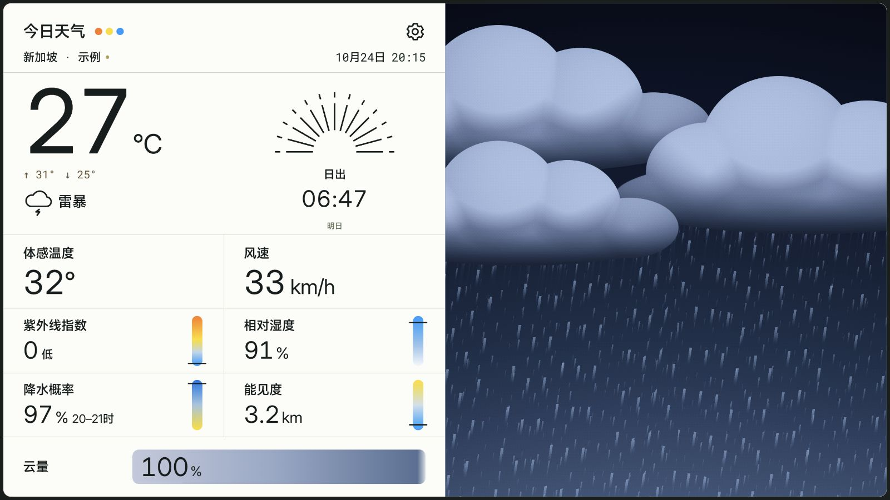
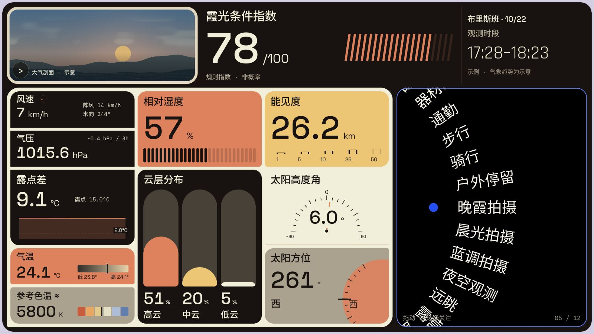

# BARO · 晴雨

**Half data, half sky.**

Today's weather on the left, a living pixel sky on the right.

Bilingual, built for the big screen. Data by Open-Meteo.

[](https://github.com/dpan538/baro/actions/workflows/ci.yml)
[](LICENSE)


[**Run the web preview**](PREVIEW.md) · [Project status](docs/IMPLEMENTATION-STATUS.md) · [中文说明](#中文说明) · [Architecture](docs/ARCHITECTURE.md) · [UI system](docs/DESIGN-SYSTEM.md) · [Daytime](docs/images/weather-english.jpg) · [Sunrise](docs/images/weather-dawn.jpg) · [Sunset](docs/images/weather-sunset.jpg)

> **Native development:** Kotlin Android, an independent BARO relay and real Open-Meteo integration are implemented and undergoing native visual/installation acceptance. The frozen browser UI remains at [`ui-baseline-2026-10-23`](https://github.com/dpan538/baro/tree/ui-baseline-2026-10-23). See the [native build guide](android/README.md), [field inventory](docs/NATIVE-DATA-SOURCES.md) and [evidence ledger](docs/ANDROID-IMPLEMENTATION.md). Public deployment and a stable APK are not yet verified.



## What is included

- A purpose-driven second instrument page with twenty-eight coupled modules, a lower-right touch dial, its own typography and panoramic pixel scene. [Panel behavior and data limits](docs/INSTRUMENT-PANEL.md) · [User requirements and acceptance record](docs/USER-DESIGN-REQUIREMENTS.md). Each metric has one owner; dew-point values/trend stay together, and one window replaces duplicate clocks.
- A nearly fullscreen tablet layout: weather information on the left, animated pixel sky on the right.
- Eleven sample scenarios with distinct cities, local times, temperatures and conditions. The three coloured dots open the scene library.
- A shared weather system with native-density fine artwork up to 1536 columns and 96-column block artwork, ordered dithering, and continuous animation targeting 24 fps. Cloud layers cross the sky over minutes; lighting, precipitation and occasional events follow independent rhythms.
- Clear orange, yellow and azure accents, controlled sky highlights, a neutral paper data panel and weather-linked cloud-meter gradients; natural cloud contours, coupled atmospheric light, cloud-based precipitation, layered wind, fine drifting fog around an island lighthouse, textured sun/moon surfaces and brighter layered stars. Dawn and sunset have different compositions, bird passages and perspective sea reflections.
- Separate Chinese and English interfaces; °C/°F and km/h, m/s and mph controls.
- Daily highs/lows, feels-like temperature, humidity, UV index, precipitation chance, visibility and cloud cover. Sunrise/sunset follows the scenario's local time.
- A left-panel settings screen with seven primary appearance, unit, location and version controls; cache, sources and feedback live under the footer menu.




## Develop

Use JDK 17/21 and Android SDK 36 for the Kotlin app; see [native instructions](android/README.md). Node.js 22+ is used for the preserved browser reference and its source checks.

```sh
git clone https://github.com/dpan538/baro.git
cd baro
npm ci --ignore-scripts
npm run check
npm run gallery
npm run dev
```

Open `http://127.0.0.1:4175/`; `/gallery.html` compares complete pages; choose the observation page there, or open `/?weather=storm&page=sky&lang=zh`. Swipe right from weather to enter and left to return. For example: `?weather=storm&lang=en&pixels=fine&motion=on`.

Android CI builds the Kotlin preview, runs backend/domain/lint checks and exercises a disposable emulator. Its debug artifact is not a stable release and may have a different development certificate from local builds.

For native builds, configure `ANDROID_HOME` or an untracked `android/local.properties`. The checked-in Gradle wrapper pins version 8.13 and verifies its distribution checksum. Generated packages remain outside Git.

`dist/` contains the authored, frozen browser reference. The native APK uses Kotlin Canvas/View controls and OpenGL ES, and does not embed that webpage. The dedicated [backend](backend/README.md) supplies shared upstream caching, place search and a server-side feedback relay; public deployment remains a separate configured step.

## Data, privacy and distribution

The Kotlin app fetches real weather and air quality as model estimates, with explicit source timestamps, missing values, offline/stale cache and no shipping sample-data mode. Foreground location changes the forecast place only after a valid fix; denied or unavailable location retains the selected place. No account, telemetry or background tracking is included.

Native updates compare versionCode and verify downloaded APK hash, package, version and installed signer before opening the Android installer. Feedback retains failed drafts and accepts success only after an independently verified Issue receipt; it needs a dedicated BARO server credential. Public release/download and feedback delivery are not yet accepted. See [privacy](docs/PRIVACY.md), [native distribution](docs/ANDROID-DISTRIBUTION.md) and the [acceptance ledger](docs/ANDROID-IMPLEMENTATION.md).

The current Xiaomi Pad 9 Pro Max target and Android inset contract are documented in [the tablet display contract](docs/TABLET-DISPLAY-CONTRACT.md). Use [the local device preview](http://127.0.0.1:4175/tablet-preview.html) for exact 3:2 / 2:3 geometry.

## 中文说明

**BARO，中文名「晴雨」。一半数据，一半天空。**

左边是今日天气，右边是流动的像素天空。中文或英文界面，为大屏而生；气象数据路线采用 Open-Meteo。

第二页是独立的环境观测仪器面板：二十九个模块、右下目的拨轮与专用横向像素视窗。拨轮选择用户目的和关注点，联动信息组合；底部环境解读把与当前目的有关的温湿、风雨、光线或器材结露条件汇成更大字的圆角段落，并补充闷热、结露、水汽或光线等相关解释。原生 App 在任一主页面完成左滑或右滑，都会切换到另一页。产品只使用真实 API 模型数据与明确说明的派生计算；无示例入口或示例数据，缺失字段保留 —。

冻结网页 UI 作为原生移植的视觉合同。Kotlin、独立后端和真实 Open-Meteo/CAMS 接入已实现，正在持续进行模拟器截图与安装验收，见[实施记录](docs/ANDROID-IMPLEMENTATION.md)。界面一次只显示中文或英文，不提供中英并排模式。公开部署、正式签名和小米真机验收仍单列为未验证项。

源码、文档、构建与分发分开组织，参考同作者的 Annota 工程。BARO 原生端使用 Kotlin / Canvas / OpenGL ES，独立维护后端；没有挪用 Annota 的阅读器功能、生产服务、Token 或签名身份。

[运行网页预览](PREVIEW.md) · [使用反馈](https://github.com/dpan538/baro/issues/new/choose) · [贡献说明](CONTRIBUTING.md)

## License and credits

Authored code and engineering documents use [MIT](LICENSE). Bundled fonts retain their own licenses: MiSans by Xiaomi, Inter and Roboto Mono under OFL 1.1. MiSans files are original vendor bytes bundled as application resources, not a standalone font distribution. See [third-party notices](THIRD_PARTY_NOTICES.md).

Open-Meteo and CAMS attribution applies to the weather-data route. BARO is an independent project with no affiliation to Xiaomi or Open-Meteo.
