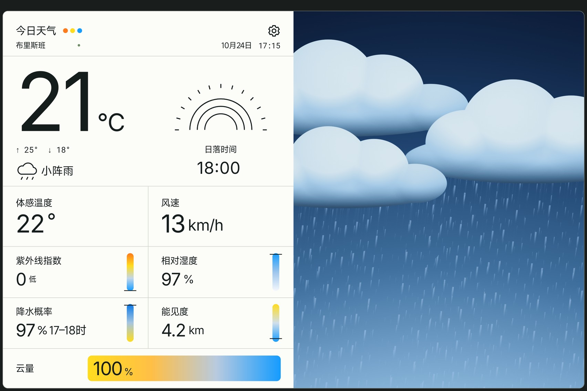
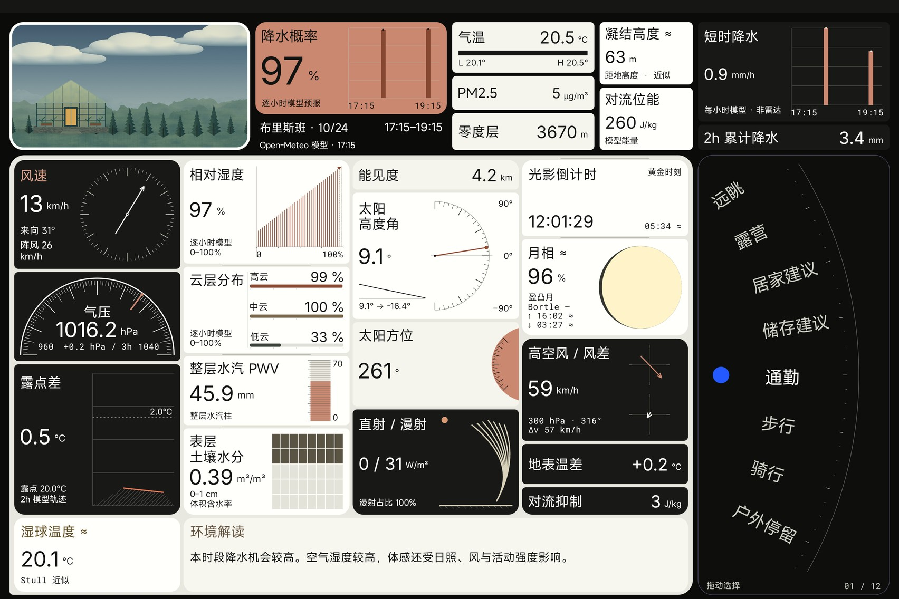
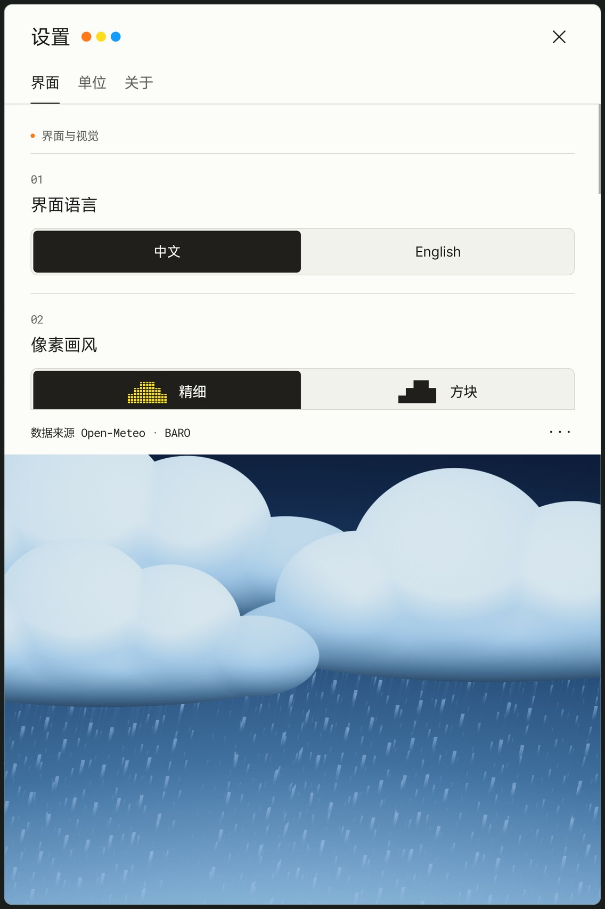

# BARO · 晴雨

**Half data, half sky.**

Today's weather on the left, a living pixel sky on the right.

Bilingual, built for the big screen. Data by Open-Meteo.

[](https://github.com/dpan538/baro/releases/tag/v0.10.0-preview.2)
[](https://github.com/dpan538/baro/actions/workflows/ci.yml)
[](LICENSE)


**待发布修复版：0.10.0-preview.4 / 16。** 已包含首页全屏、前台 15 分钟自动更新与过期数据清除、日出和降水排版修正，以及平板内存余量调整。新 APK 已本地验证，下面的公开下载入口仍为 preview.2。[修复与验收说明](docs/ANDROID-PREVIEW-4-CHANGES.md)。

[**下载 Android 测试 APK / Download APK ↗**](https://github.com/dpan538/baro/releases/download/v0.10.0-preview.2/BARO-0.10.0-preview.2.apk) · [下载与安装 / Install on your Pad](DOWNLOAD.md) · [版本说明 / Release notes](https://github.com/dpan538/baro/releases/tag/v0.10.0-preview.2) · [SHA-256](https://github.com/dpan538/baro/releases/download/v0.10.0-preview.2/SHA256SUMS)

**首个公开测试版：0.10.0-preview.2 · Android 10+ · 20.5 MB。** 在平板浏览器中直接点击上面的 APK 链接，下载完成后打开安装。后续从「设置 → 关于 → 检查更新」下载并确认覆盖升级；同签名测试版保留设置和草稿，无须先卸载。

[**Run the web preview**](PREVIEW.md) · [Project status](docs/IMPLEMENTATION-STATUS.md) · [中文说明](#中文说明) · [Architecture](docs/ARCHITECTURE.md) · [UI system](docs/DESIGN-SYSTEM.md) · [Daytime](docs/images/weather-english.jpg) · [Sunrise](docs/images/weather-dawn.jpg) · [Sunset](docs/images/weather-sunset.jpg)

> **First public Android preview:** a signed, non-debug Kotlin APK with two main pages, native Settings and real Open-Meteo/CAMS data. The exact published package has 72 native emulator captures across both languages, orientations and two display densities, plus Settings, keyboard/animated-sky and update-safety checks. Anonymous public APK delivery is verified. This preview uses a persistent BARO test certificate; public feedback/backend deployment, production signing and Xiaomi hardware acceptance remain separate. See [download instructions](DOWNLOAD.md), the [native build guide](android/README.md) and [preview acceptance](android/verification/preview-0.10.0-preview.2.json). The frozen browser reference remains at [`ui-baseline-2026-10-23`](https://github.com/dpan538/baro/tree/ui-baseline-2026-10-23).



Screenshots below are from the published preview's native Android emulator acceptance, not Xiaomi hardware. Historical browser studies remain linked above.

## What is included

- A purpose-driven second instrument page with twenty-nine modules, a lower-right touch dial and its own panoramic pixel scene. [Native field sources and limits](docs/NATIVE-DATA-SOURCES.md). Each metric has one owner; dew-point values/trend stay together, and one selected forecast window drives the instruments.
- A nearly fullscreen tablet layout: weather information on the left, animated pixel sky on the right.
- Real weather and air-quality model data, city search, optional foreground location and explicit source times. Production contains no sample scenes, scene library or page-switch button; the three coloured dots are decorative.
- Authored OpenGL ES weather artwork with fine samples up to 1536 columns, a 96-column weather block mode, a 192-column observation block mode and a 45-second weather loop. Rendering pauses in the background. Emulator evidence does not establish tablet frame rate or power use.
- Clear orange, yellow and azure accents, controlled sky highlights, a neutral paper data panel and weather-linked cloud-meter gradients; natural cloud contours, coupled atmospheric light, cloud-based precipitation, layered wind, fine drifting fog around an island lighthouse, textured sun/moon surfaces and brighter layered stars. Dawn and sunset have different compositions, bird passages and perspective sea reflections.
- Separate Chinese and English interfaces; °C/°F and km/h, m/s and mph controls.
- Daily highs/lows, feels-like temperature, humidity, UV index, precipitation chance, visibility and cloud cover. Dates and solar events follow the provider's local timezone; missing fields remain `—` and derived values identify their method.
- A left-panel settings screen with seven primary appearance, unit, location and version controls; cache, sources and feedback live under the footer menu.



<a href="docs/images/native-preview-2-settings-portrait-zh.jpg"></a>

Portrait Settings occupies the upper information pane and leaves the animated sky visible below. Landscape Settings uses the left pane.

## Develop

Use JDK 17/21 and Android SDK 36 for the Kotlin app; see [native instructions](android/README.md). Node.js 22+ is used for the preserved browser reference and its source checks.

```sh
git clone https://github.com/dpan538/baro.git
cd baro
npm ci --ignore-scripts
npm run check
npm run gallery
npm run dev
```

Open `http://127.0.0.1:4175/`; `/gallery.html` compares complete pages; choose the observation page there, or open `/?weather=storm&page=sky&lang=zh`. Swipe right from weather to enter and left to return. For example: `?weather=storm&lang=en&pixels=fine&motion=on`.

These browser URLs and sample scenes belong to the frozen design reference. The native product has exactly two main pages; a completed swipe in either direction switches to the other page.

Android CI builds the Kotlin preview, runs backend/domain/lint checks and exercises native UI gestures on a disposable emulator. Hosted checks suppress GLES through androidTest-only callbacks and skip product captures; full live-data/GLES screenshot acceptance is local. Its debug artifact is not a stable release and may have a different development certificate from local builds.

For native builds, configure `ANDROID_HOME` or an untracked `android/local.properties`. The checked-in Gradle wrapper pins version 8.13 and verifies its distribution checksum. Generated packages remain outside Git.

`dist/` contains the authored, frozen browser reference. The native APK uses Kotlin Canvas/View controls and OpenGL ES, and does not embed that webpage. The dedicated [backend](backend/README.md) supplies shared upstream caching, place search and a server-side feedback relay; public deployment remains a separate configured step.

## Data, privacy and distribution

The Kotlin app fetches real weather and air quality as model estimates, with explicit source timestamps, missing values, offline/stale cache and no shipping sample-data mode. Foreground location changes the forecast place only after a valid fix; denied or unavailable location retains the selected place. No account, telemetry or background tracking is included.

Native updates compare versionCode and verify downloaded APK hash, package, version and installed signer before opening the Android installer. The [public preview APK](https://github.com/dpan538/baro/releases/download/v0.10.0-preview.2/BARO-0.10.0-preview.2.apk), update manifest and checksums are available without signing in; downloaded bytes match the reviewed package. Feedback retains failed drafts and accepts success only after an independently verified Issue receipt; the dedicated public BARO feedback relay is not configured. See [privacy](docs/PRIVACY.md), [native distribution](docs/ANDROID-DISTRIBUTION.md) and the [acceptance ledger](docs/ANDROID-IMPLEMENTATION.md).

The current Xiaomi Pad 9 Pro Max target and Android inset contract are documented in [the tablet display contract](docs/TABLET-DISPLAY-CONTRACT.md). Use [the local device preview](http://127.0.0.1:4175/tablet-preview.html) for exact 3:2 / 2:3 geometry.

## 中文说明

**BARO，中文名「晴雨」。一半数据，一半天空。**

[**在 Pad 上直接下载测试 APK ↗**](https://github.com/dpan538/baro/releases/download/v0.10.0-preview.2/BARO-0.10.0-preview.2.apk) · [安装与覆盖升级说明](DOWNLOAD.md)

左边是今日天气，右边是流动的像素天空。中文或英文界面，为大屏而生；气象数据路线采用 Open-Meteo。

第二页是独立的环境观测仪器面板：二十九个模块、右下目的拨轮与专用横向像素视窗。拨轮选择用户目的和关注点，联动信息组合；底部环境解读把与当前目的有关的温湿、风雨、光线或器材结露条件汇成更大字的圆角段落，并补充闷热、结露、水汽或光线等相关解释。原生 App 在任一主页面完成左滑或右滑，都会切换到另一页。产品只使用真实 API 模型数据与明确说明的派生计算；无示例入口或示例数据，缺失字段保留 —。

冻结网页 UI 作为原生移植的视觉合同。首个公开测试包为 **0.10.0-preview.2 / 14**，采用 G1b 图标。两个主页面与七项设置已有原生验收；本包中英、横竖屏、两种显示密度共 72 张原生截图，设置交互、真实键盘与露出天空持续渲染的检查已通过，见[测试版验收](android/verification/preview-0.10.0-preview.2.json)。界面一次只显示中文或英文，不提供中英并排模式。公开 APK 已匿名下载核验；独立后端/反馈的公开部署、商店正式签名和小米真机验收仍单列。

源码、文档、构建与分发分开组织，参考同作者的 Annota 工程。BARO 原生端使用 Kotlin / Canvas / OpenGL ES，独立维护后端；没有挪用 Annota 的阅读器功能、生产服务、Token 或签名身份。

[运行网页预览](PREVIEW.md) · [使用反馈](https://github.com/dpan538/baro/issues/new/choose) · [贡献说明](CONTRIBUTING.md)

## License and credits

Authored code and engineering documents use [MIT](LICENSE). Bundled fonts retain their own licenses: MiSans by Xiaomi, Inter and Roboto Mono under OFL 1.1. MiSans files are original vendor bytes bundled as application resources, not a standalone font distribution. See [third-party notices](THIRD_PARTY_NOTICES.md).

Open-Meteo and CAMS attribution applies to the weather-data route. BARO is an independent project with no affiliation to Xiaomi or Open-Meteo.
