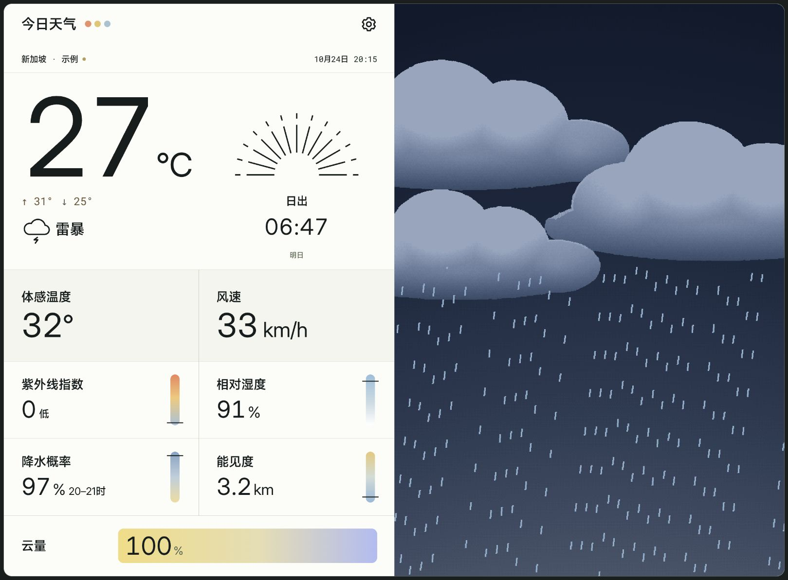
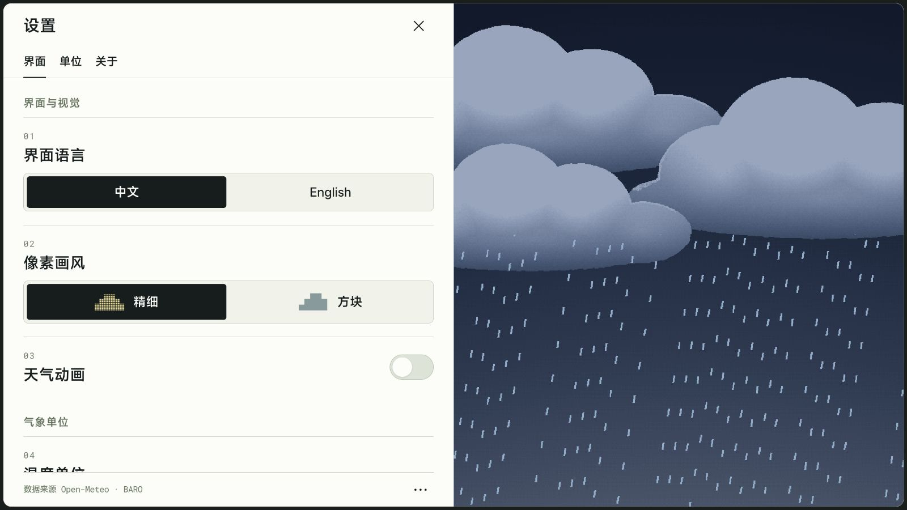

# BARO · 晴雨

**Half data, half sky.**

Today's weather on the left, a living pixel sky on the right.

Bilingual, built for the big screen. Data by Open-Meteo.

[](https://github.com/dpan538/baro/actions/workflows/ci.yml)
[](LICENSE)


[**Run the web preview**](PREVIEW.md) · [Project status](docs/IMPLEMENTATION-STATUS.md) · [中文说明](#中文说明) · [Architecture](docs/ARCHITECTURE.md) · [UI system](docs/DESIGN-SYSTEM.md) · [English screenshot](docs/images/weather-english.png)

> **Current status:** this is a weather-screen design prototype with clearly labelled sample data. We are refining the browser layout first; APK packaging and publishing are paused. Open-Meteo adapters are tested against recorded responses, but live forecast fetching is not connected yet.



## What is included

- A nearly fullscreen tablet layout: weather information on the left, animated pixel sky on the right.
- Eleven sample scenarios with distinct cities, local times, temperatures and conditions. The three coloured dots open the scene library.
- A shared weather system with 768-column fine artwork and 96-column block artwork, ordered dithering, and an eight-second animation loop targeting 24 fps.
- Separate Chinese and English interfaces; °C/°F and km/h, m/s and mph controls.
- Daily highs/lows, feels-like temperature, humidity, UV index, precipitation chance, visibility and cloud cover. Sunrise/sunset follows the scenario's local time.
- A left-panel settings screen with seven primary appearance, unit, location and version controls; cache, sources and feedback live under the footer menu.



## Develop

Use Node.js 22+ for the current browser prototype. The existing Android scaffold can be resumed later with JDK 17/21 and Android SDK 36.

```sh
git clone https://github.com/dpan538/baro.git
cd baro
npm ci --ignore-scripts
npm run check
npm run gallery
npm run dev
```

Open `http://127.0.0.1:4175/`; `/gallery.html` compares complete pages. For example: `?weather=storm&lang=dual&pixels=fine&motion=on`.

The Android wrapper and host are retained for later integration. Automatic CI runs source checks and generates the web gallery; it does not build or publish APKs.

When Android work resumes, configure `ANDROID_HOME` or an untracked `android/local.properties`. The checked-in Gradle wrapper pins version 8.13 and verifies its distribution checksum. Generated packages remain outside Git.

`dist/` contains the authored web source bundled in the Android WebView, not generated output. Java handles the offline asset origin, foreground device services and system navigation; WebGL2 draws the weather artwork. No frontend framework or production backend is required for this preview.

## Data, privacy and distribution

Weather and air-quality values are sample fixtures, never presented as live observations. The retained Android host has no Internet permission. Optional Android location works only while the activity is visible and does not replace sample weather with real data. Browser previews never request your location.

Update checking currently opens this repository's Releases page. Feedback opens GitHub's issue chooser or copies the draft; it does not submit an Issue automatically. There is no in-app APK downloader, background tracker, account or telemetry.

See [preview instructions](PREVIEW.md), [privacy](docs/PRIVACY.md), [implementation status](docs/IMPLEMENTATION-STATUS.md) and the [Open-Meteo field contract](docs/open-meteo-contract.md). UI and rendering have been checked in browsers and an Android emulator at 3456×2304; that is not a claim of complete Xiaomi device acceptance.

## 中文说明

**BARO，中文名「晴雨」。一半数据，一半天空。**

左边是今日天气，右边是流动的像素天空。中文或英文界面，为大屏而生；气象数据路线采用 Open-Meteo。

当前先完成最重要的天气首页：十一种示例天气、精细／方块动画、日出日落切换、大字信息网格与完整设置。界面一次只显示一种语言，不提供中英并排模式。项目统一使用 BARO 名称。当前先迭代网页原型，不构建或发布新的 APK；原有 Android 壳层保留供后续接入。

源码、文档、构建与分发分开组织，参考同作者的 Annota 工程。BARO 当前使用 Java/WebView/WebGL2；它不是 Annota 的原生阅读器，也不包含其 PDF、笔迹或反馈服务。

[运行网页预览](PREVIEW.md) · [使用反馈](https://github.com/dpan538/baro/issues/new/choose) · [贡献说明](CONTRIBUTING.md)

## License and credits

Authored code and engineering documents use [MIT](LICENSE). Bundled fonts retain their own licenses: MiSans by Xiaomi, Inter and Roboto Mono under OFL 1.1. MiSans files are original vendor bytes bundled as application resources, not a standalone font distribution. See [third-party notices](THIRD_PARTY_NOTICES.md).

Open-Meteo and CAMS attribution applies to the weather-data route. BARO is an independent project with no affiliation to Xiaomi or Open-Meteo.
