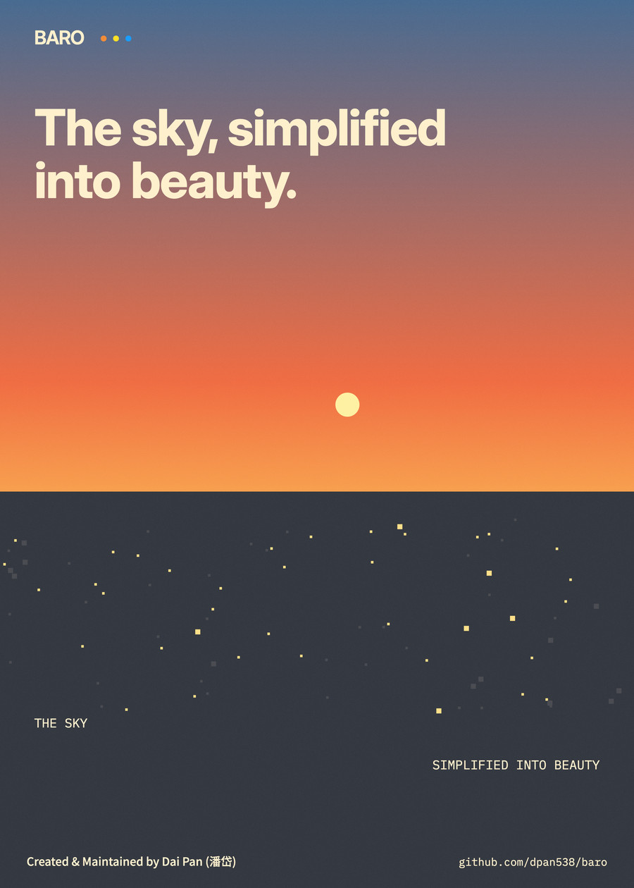
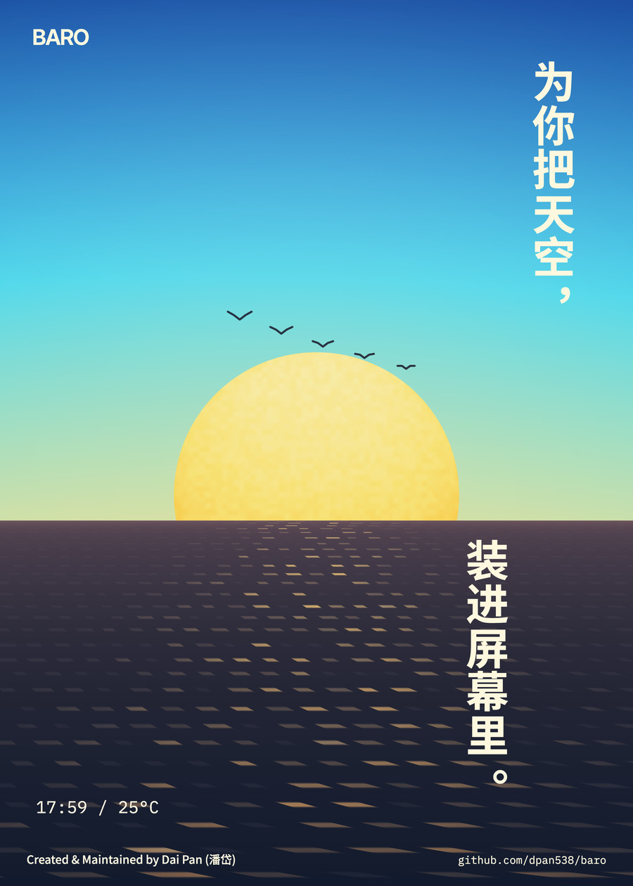
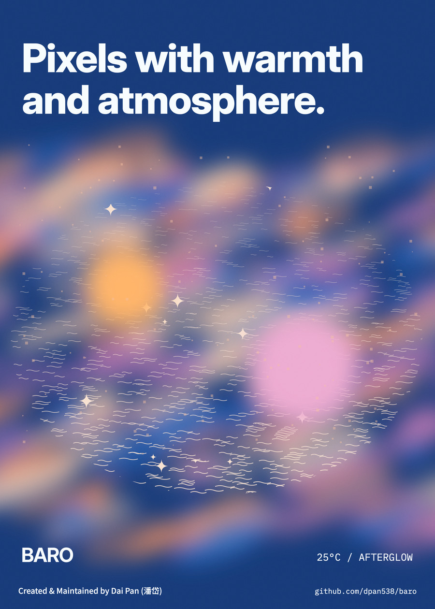
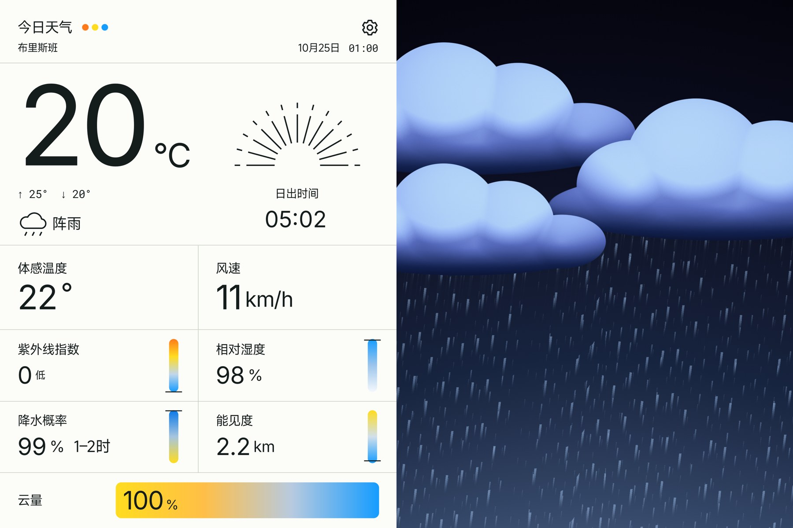
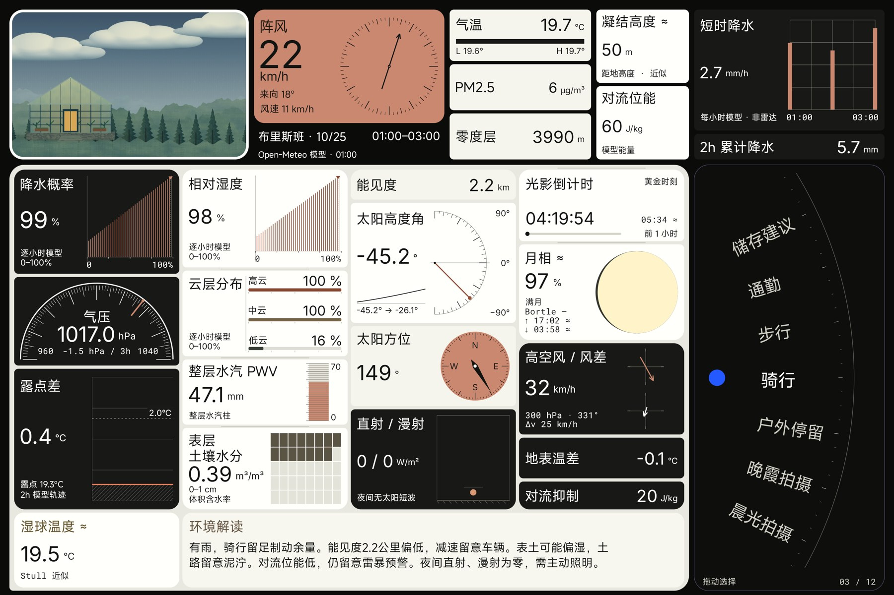

# BARO · 晴雨

**Half data, half sky.** 一半数据，一半天空。

**专为小米 Pad 9 Pro Max 开发。** 后续将逐步适配其他尺寸的小米 Pad。

[](https://github.com/dpan538/baro/releases/tag/v0.10.0-preview.6-r2)
[](https://github.com/dpan538/baro/actions/workflows/ci.yml)
[](https://github.com/dpan538/baro/actions/workflows/android.yml)
[](LICENSE)


[**直接下载 Android 测试 APK ↗**](https://github.com/dpan538/baro/releases/download/v0.10.0-preview.6-r2/BARO-0.10.0-preview.6-r2.apk) · [Pad 安装与覆盖升级](DOWNLOAD.md) · [版本说明](https://github.com/dpan538/baro/releases/tag/v0.10.0-preview.6-r2) · [SHA-256](https://github.com/dpan538/baro/releases/download/v0.10.0-preview.6-r2/SHA256SUMS)

**当前公开测试版：0.10.0-preview.6-r2 · Android 10+ · 20.6 MB。** 在平板浏览器中直接点击 APK 链接，下载后打开安装。同签名测试版可覆盖升级，保留设置与草稿；后续可从「设置 → 关于 → 检查更新」下载。

<table>
  <tr>
    <td width="33.33%"><a href="docs/images/readme-posters/sky-simplified.jpg"></a></td>
    <td width="33.33%"><a href="docs/images/readme-posters/sky-in-screen.jpg"></a></td>
    <td width="33.33%"><a href="docs/images/readme-posters/pixels-with-warmth.jpg"></a></td>
  </tr>
</table>

## 两页原生全屏交互

BARO 将天气与环境信息收进两页原生界面，无示例数据模式。在任一主页面完成左滑或右滑，即可切换到另一页。

- **主页｜天气与像素天空**：内容铺满屏幕，不预留常驻系统栏白条。左侧是中性纸质数据面板，右侧是由项目源码绘制的 OpenGL ES 动态像素天空，精细模式最高 1536 列采样、天气动画 45 秒循环。云层、岛屿雾气、晨昏海面倒影、日月与星空共同构成画面；竖屏重排为上下分区。
- **第二页｜环境观测仪表盘**：29 个观测与信息模块，通过右下目的拨轮联动 12 种活动。露点与趋势、能见度、对流条件、直漫射光线、光窗进度与色温补偿建议，均围绕所选时段组织。环境解读保留完整短句，最多两行。

## 工程与技术契约

- **原生性能**：Kotlin 原生 Android，结合 Canvas / View 与 OpenGL ES，无 WebView。后台暂停渲染；系统关闭动画时即时完成切换。
- **数据真实性**：真实 Open-Meteo / CAMS 模型数据，前台约每 15 分钟刷新，失败约每 5 分钟重试。缺失字段显示 `—`，近似计算注明方法；过期读数不继续作为当前天气展示。
- **冻结 Web 参考**：Node.js 与静态 HTML / CSS / JavaScript 仅用于开发、源码检查和 `/gallery.html` 视觉契约比对，不打包进原生应用。
- **更新与隐私**：比对 `versionCode`，分别校验 APK 的 SHA-256、包名、版本与签名证书，再交给 Android 系统安装器。无账户、第三方遥测或后台位置追踪；自动定位仅在应用可见时运行。

Developed specifically for **Xiaomi Pad 9 Pro Max**, with support for other Xiaomi Pad sizes planned progressively. Two native full-screen pages, real model data, separate Chinese and English interfaces, and source-authored pixel skies. The posters above are design artwork; native screenshots below come from emulator acceptance, not Xiaomi hardware performance tests.





[下载与验收](DOWNLOAD.md) · [数据来源与解释边界](docs/NATIVE-DATA-SOURCES.md) · [项目状态](docs/IMPLEMENTATION-STATUS.md) · [原生架构](docs/ARCHITECTURE.md) · [界面系统](docs/DESIGN-SYSTEM.md) · [冻结网页参考](PREVIEW.md)

## Develop

Use JDK 17/21 and Android SDK 36 for the Kotlin app; see [native instructions](android/README.md). Node.js 22+ is used for the preserved browser reference and its source checks.

```sh
git clone https://github.com/dpan538/baro.git
cd baro
npm ci --ignore-scripts
npm run check
npm run gallery
npm run dev
```

Open `http://127.0.0.1:4175/`; `/gallery.html` compares complete pages; choose the observation page there, or open `/?weather=storm&page=sky&lang=zh`. Swipe right from weather to enter and left to return. For example: `?weather=storm&lang=en&pixels=fine&motion=on`.

These browser URLs and sample scenes belong to the frozen design reference. The native product has exactly two main pages; a completed swipe in either direction switches to the other page.

Android CI builds the Kotlin preview, runs backend/domain/lint checks and exercises native UI gestures on a disposable emulator. Hosted checks suppress GLES through androidTest-only callbacks and skip product captures; full live-data/GLES screenshot acceptance is local. Its debug artifact is not a stable release and may have a different development certificate from local builds.

For native builds, configure `ANDROID_HOME` or an untracked `android/local.properties`. The checked-in Gradle wrapper pins version 8.13 and verifies its distribution checksum. Generated packages remain outside Git.

`dist/` contains the authored, frozen browser reference and is not embedded in the APK. The optional [weather backend](backend/README.md) provides shared caching and place search; this preview fetches real weather directly. The separate [BARO feedback service](feedback-service/README.md) runs publicly on Vercel and does not proxy weather or location.

## Data, privacy and distribution

The Kotlin app fetches real weather and air quality as model estimates, with explicit source timestamps, missing values, bounded valid-data caching and no shipping sample-data mode. Foreground location changes the forecast place only after a valid fix; denied or unavailable location retains the selected place. No account, telemetry or background tracking is included.

Native updates compare versionCode and verify downloaded APK hash, package, version and installed signer before opening the Android installer. The [public preview APK](https://github.com/dpan538/baro/releases/download/v0.10.0-preview.6-r2/BARO-0.10.0-preview.6-r2.apk), update manifest and checksums are available without signing in; downloaded bytes match the reviewed package. Feedback now follows App → BARO Vercel service → GitHub Issue → independently verified receipt. The form shows submitted/retry status and retains failed drafts. Both languages and offline retention passed actual native acceptance ([test receipt](https://github.com/dpan538/baro/issues/1)). See [privacy](docs/PRIVACY.md), [native distribution](docs/ANDROID-DISTRIBUTION.md) and the [acceptance ledger](docs/ANDROID-IMPLEMENTATION.md).

The current Xiaomi Pad 9 Pro Max target and Android inset contract are documented in [the tablet display contract](docs/TABLET-DISPLAY-CONTRACT.md). Use [the local device preview](http://127.0.0.1:4175/tablet-preview.html) for exact 3:2 / 2:3 geometry.

## License and credits

Authored code and engineering documents use [MIT](LICENSE). Bundled fonts retain their own licenses: MiSans by Xiaomi, Inter and Roboto Mono under OFL 1.1. MiSans files are original vendor bytes bundled as application resources, not a standalone font distribution. See [third-party notices](THIRD_PARTY_NOTICES.md).

Open-Meteo and CAMS attribution applies to the weather-data route. BARO is an independent project with no affiliation to Xiaomi or Open-Meteo.
