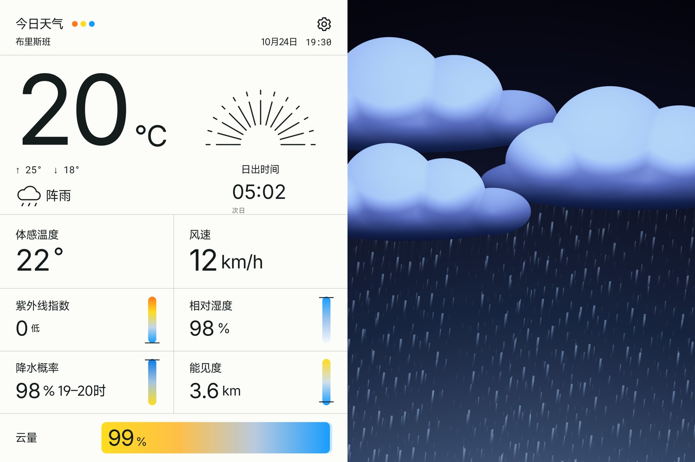

# Pad field-test follow-up: 0.10.0-preview.3

Prepared locally on 2026-10-24. This APK has **not** been publicly published. Automatic approval blocked the GitHub source push pending explicit publication permission. The published download remains preview.2; prepared README/download replacements and release assets remain local until publication.

The first page now hides system bars and fills the display. There is no status-bar placeholder, outer preview rim or right-edge border; landscape sky reaches the top edge. Observation keeps a readable light status region inside its own page without resizing the shared swipe viewport. This follows the user's correction that replacing a black strip with a white strip was insufficient.

City selection uses a styled, cancellable native dialog. Automatic foreground location accepts recent valid system fixes or requests a new one, selects coordinates and refreshes weather without requiring manual city entry. Settings refreshes its actual fix state and provides retry. Denied/unavailable location keeps the selected place. The persistent city-adjacent AQI dot is removed.

The short-term precipitation chart shares bounded plot/grid coordinates and headroom. Current wet conditions are rendered independently over the selected environmental panorama. Page travel follows finger displacement; a second touch can grab the settling page without snapping. Settings uses 340 ms opening / 300 ms closing linear transitions, and page settling uses 180–420 ms with immediate reduced-motion behavior.

Package: `studio.sundown.weather`, code **15**, non-debug preview, application source `11bce1522448814b14893530795c4e29e8f58d2c`. The persistent BARO preview certificate matches public preview.2. The APK is 20,479,900 bytes; its SHA-256 is `fd3960beae64bc344eb7aeb69bd2c9683a8376c47f6dc573da44a423373ba76d`. Original G1b launcher pixels, fonts/licenses and frozen UI tag are preserved. No image generation was used.

See the [exact-package acceptance record](../android/verification/preview-0.10.0-preview.3.json) for test scope, initial failures and remaining boundaries. Emulator GPS uses an explicitly controlled system provider; it does not establish Xiaomi location behavior. Screenshots with recorded/controlled inputs are distinguished from genuine-provider product captures. No public feedback message was sent.

This image is from the exact local signed APK on the disposable emulator; it is not a Xiaomi hardware capture. [Image provenance](images/native-preview-3-sources.json).

The final package passes 22 preview unit tests, preview lint/build and source checks. Twenty distinct native methods passed (22 successful invocations counting repeated pixel modes and capture densities). The two capture matrices save 72 images across Chinese/English, landscape/portrait and 320/400 dpi, with actual provider responses; controlled long release notes remain labelled. The high-density viewport test exercises all twelve purposes and touch ownership. Initial failures and the corrected test preconditions/probes remain recorded.
