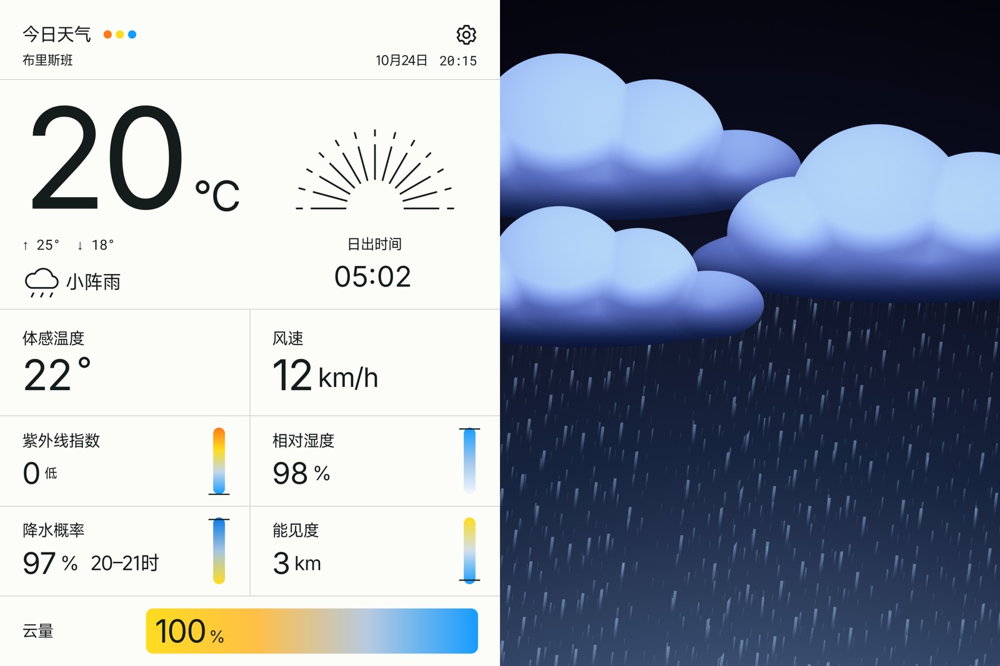

# Foreground refresh and Pad refinements: preview.4

`0.10.0-preview.4 / 16` is a local signed, non-debug APK from source `1e9cfe1d789c919e515bb9ef59fbe9c4cee79403`. It is not publicly published: automatic approval blocked the source push pending explicit permission. Public download buttons still point to preview.2; new release assets and README/download replacements are prepared locally. Earlier preview.3 and its full process evidence are retained.

A one-second foreground heartbeat now schedules a real weather read every **15 minutes**, using elapsed time. Failures retry after **five minutes**. Each request has a **45-second total deadline**, and the Activity has an independent loading watchdog. Returning to the foreground refreshes subject to the same minimum read gate. Successful responses replace parsed memory and disk JSON; a new fetch cannot renew an old provider timestamp. Fetch/source timestamps expire at **30 minutes**, and expired active readings and selected-place disk entries are removed. The UI shows weather, updating or unavailable states without internal cache labels. There is no background polling. The optional backend cache now expires after 15 minutes and deletes old rows instead of returning stale-on-error data; its tests are local, not a deployment claim.

Sunrise no longer has a next-day caption. Precipitation time intervals are drawn separately with a deliberate gap after the percentage. All earlier full-bleed, location, chart, environmental-rain and linear-transition changes are included. The Pad requests Android's larger managed heap, verified in the APK and installed package flags; valid-place capacity is 24. This permits extra headroom without claiming a fixed allocation or Xiaomi performance result.

The exact APK is **20,483,468 bytes**, SHA-256 `5f62793d7894bbfd99c2dd1720d547377460c22698f7884dda70e96892c46f5c`. Its persistent BARO preview certificate matches previous test builds. The installed APK bytes match the prepared artifact. Preserve app data when installing over an earlier test version.

Validation: **27 unit tests**, **15 backend tests**, **10 Android HTTP/heartbeat methods** with accelerated clocks and loopback transport, then **five field methods on the exact signed preview** and a **36-image genuine-provider native matrix** covering Chinese/English and landscape/portrait at 320 dpi. Build/lint/source checks pass. The real Handler heartbeat, API replacement, disk expiry, failed retry, timeout recovery, background pause and resume were exercised without manual refresh input. Original payloads, failures, logs, screenshots, APK and checksums remain local. [Exact-package record](../android/verification/preview-0.10.0-preview.4.json). Earlier preview.3's two-density screenshots are not relabelled as current-package evidence. Xiaomi GPS, system behavior, physical haptics, frame rate and power still need user follow-up testing.

This is a genuine-provider emulator capture. [Image provenance](images/native-preview-4-sources.json).
